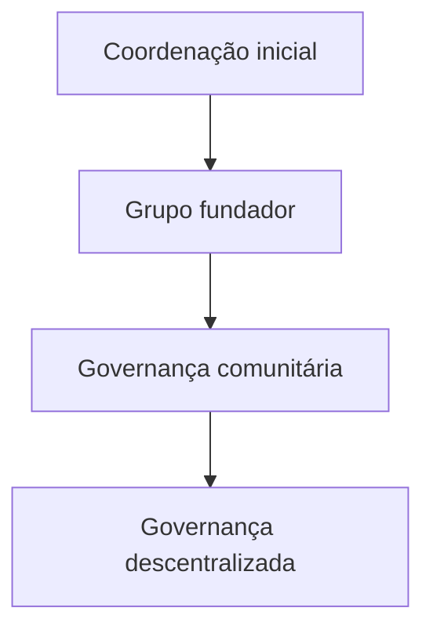

# Governança

STATUS: EM DISCUSSÃO.

Proposta de passagem da coordenação inicial à governança das bandas. Não é um regimento aprovado. O princípio “uma banda, um voto” está em estudo. Não está adotado.

Documentos ligados: [MANIFESTO.md](MANIFESTO.md), [VISION.md](VISION.md), [CONTRIBUTING.md](CONTRIBUTING.md), [CODE_OF_CONDUCT.md](CODE_OF_CONDUCT.md).

## Quem decide o quê

As bandas devem, em conjunto, definir:

- admissão de novas bandas;
- regras econômicas e critérios de distribuição;
- políticas de conteúdo;
- diretrizes de desenvolvimento e prioridades do produto;
- orçamento e manutenção da infraestrutura;
- regras de votação e eleição de representantes;
- resolução de conflitos.

Até existir esse corpo, ninguém fala em nome de uma comunidade já formada.

## Transição proposta

As fases podem se sobrepor. Nenhuma data está marcada.

### 1. Coordenação inicial

Quem idealizou o projeto reúne as primeiras pessoas, organiza a documentação, facilita a conversa, registra propostas e prepara decisões coletivas.

Cabe a esta coordenação:

- manter os textos honestos sobre o que já foi decidido e o que não foi;
- não escolher stack, licença, percentuais ou regra de voto sozinha;
- não transformar acesso ao repositório em poder permanente.

Critério proposto para sair desta fase: existe um grupo nomeado de pessoas que aceitaram construir a fundação, com áreas de participação reconhecidas e um processo mínimo de proposta e registro. STATUS: EM DISCUSSÃO.

### 2. Grupo fundador

O grupo fundador escreve, revisa e submete à conversa os documentos de visão, economia, governança, produto e pesquisa. Ainda não é a assembleia das bandas.

Cabe ao grupo:

- discordar por escrito;
- separar fato, hipótese e recomendação;
- recusar cargo inventado e autoridade que a comunidade não deu.

Critério proposto para a transição seguinte: há bandas participantes suficientes para deliberar admissão, conteúdo e regras econômicas, e um processo de decisão que elas reconheçam. O número mínimo de bandas está em aberto. STATUS: EM DISCUSSÃO.

### 3. Governança comunitária

As bandas passam a decidir as matérias da seção “Quem decide o quê”. A coordenação técnica, se existir, executa o que foi decidido e não detém poder econômico extra.

A entrada de bandas começa por convite e aprovação comunitária. Os detalhes do convite, do quórum e da recusa ainda não existem.

Critério proposto para estudar descentralização da própria governança: as regras off-line já funcionam por mais de um ciclo de decisão, as contas são compreensíveis e a comunidade pede uma forma mais difícil de capturar. STATUS: EM DISCUSSÃO.

### 4. Governança descentralizada

Possível evolução para regras executadas por mecanismo verificável, inclusive on-chain, se um dia a comunidade quiser e o custo couber. Não é destino obrigatório. Blockchain não está escolhida.

Antes dessa fase é preciso responder, com pesquisa e não com entusiasmo: quem paga a transação, o que acontece quando uma banda perde a chave, como se corrige um erro, e o que permanece válido se a rede escolhida encarecer ou parar.

## Uma banda, um voto

Proposta em estudo. Não aprovada.

Vantagens a examinar:

- evita que uma banda grande compre a decisão com número de ouvintes ou de apoiadores;
- combina com a ideia de que a casa pertence às bandas, não à audiência;
- é simples de explicar.

Limitações a examinar:

- uma banda de uma pessoa e uma banda de muitas pessoas teriam o mesmo peso;
- não distingue quem está ativa de quem só mantém o cadastro;
- pode ser capturada por cadastros fictícios se a admissão for frouxa;
- deixa de fora, por definição, apoiadores, mantenedores e demais colaboradores;
- não resolve empate, ausência, procuração nem banda com conflito interno.

Alternativas que também devem ser estudadas, sem preferência prévia: voto por pessoa integrante, câmaras separadas (bandas e mantenedores), quórum mais alto para dinheiro e licença, e mandatos revogáveis. Nenhuma está aprovada.

## O que a coordenação não pode fazer sozinha

- alterar percentuais de repasse e apresentá-los como regra;
- escolher licença de código;
- admitir banda em nome da comunidade;
- prometer prazo, chain ou arquitetura;
- apagar discordância do registro de decisões.

## Conflitos

Enquanto não houver processo próprio, o conflito se registra por escrito, com os fatos separados da interpretação, e fica em aberto até o grupo fundador ou, depois, as bandas o tratarem. Silêncio de quem coordena não é decisão.
