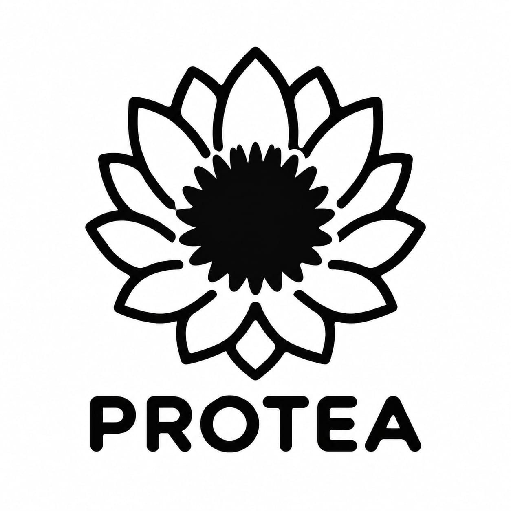

# PROTEA

Open-source, community-owned music streaming.  
Support one band, empower them all.

**Apoie uma banda. Fortaleça todas.**

Plataforma comunitária de streaming musical e encontro. Código aberto, sem fins lucrativos, governada pelas bandas e construída para fortalecer a música independente — de qualquer gênero.

A música floresce em comunidade.

## Por onde começar

| Documento | Para quê |
| --- | --- |
| [MANIFESTO.md](MANIFESTO.md) | Identidade cultural e política. Manifesto fundador, versão inicial. |
| [VISION.md](VISION.md) | O que o PROTEA pretende ser, e o que ainda não está decidido. |
| [GOVERNANCE.md](GOVERNANCE.md) | Como as decisões devem caminhar da coordenação inicial à governança das bandas. |
| [CONTRIBUTING.md](CONTRIBUTING.md) | Como participar, propor e revisar antes de existir código. |
| [CODE_OF_CONDUCT.md](CODE_OF_CONDUCT.md) | Conduta esperada na comunidade. |

## O que este repositório é agora

Fase 0: fundação documental e organização comunitária.

Ainda não há aplicação, stack escolhida nem licença de código definida. As tecnologias citadas em rascunhos anteriores — incluindo Angular, NestJS, PostgreSQL, Redis e Docker — são hipóteses históricas, não decisões.

## Referência visual

STATUS: EM DISCUSSÃO.

A identidade visual ainda será definida por quem cuidar de UX/UI. A imagem abaixo fica no repositório só como referência desta fase.

## Frases de identidade

- Apoie uma banda. Fortaleça todas.
- A música floresce em comunidade.
- A música é de quem faz. A plataforma também.

## Estado

STATUS: EM DISCUSSÃO.

O manifesto publicado é a versão fundadora. Visão, governança, participação e conduta são propostas iniciais para o grupo que está se formando. Não representam consenso de uma comunidade já constituída.
